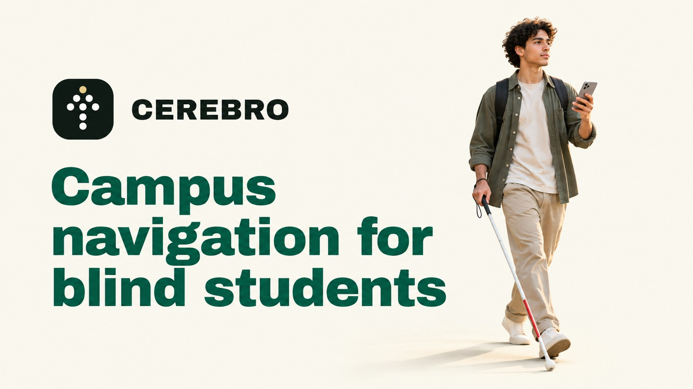
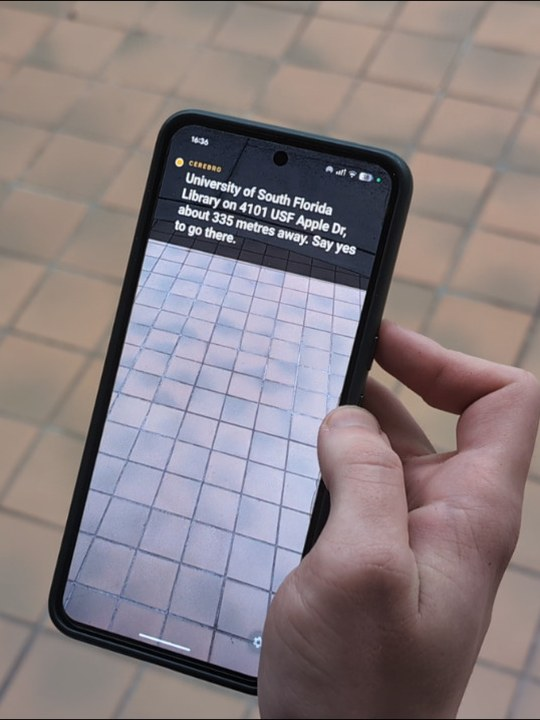
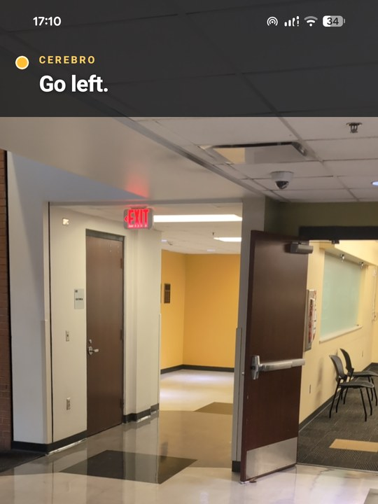
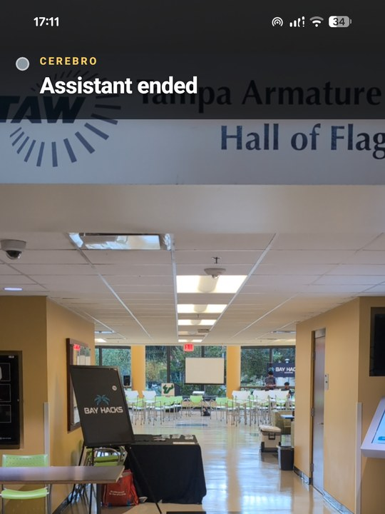

<p align="center">
  
</p>

<h1 align="center">Cerebro</h1>

<p align="center">
  Voice-first campus navigation for blind and visually impaired USF students.
  <br>
  Winner of Best Use of ElevenLabs at <a href="https://www.tampabayinnovation.com/bay-hacks">Bay Hacks 2026</a>.
</p>

<p align="center">
  
  
  
  <a href="LICENSE"></a>
</p>

<p align="center">
  <a href="https://www.youtube.com/watch?v=UgZ5OqgzG00">Demo video</a>
  ·
  <a href="https://devpost.com/software/cerebro-yixfr4">Devpost</a>
</p>

<p align="center">
  <a href="https://www.youtube.com/watch?v=UgZ5OqgzG00">
    
  </a>
</p>

## About

Cerebro (Spanish for "brain") is an Android app that guides blind and visually impaired students around the USF campus by voice. You say where you want to go. Cerebro finds the place with Google Places, gets walking directions from Google Routes, and speaks each turn through ElevenLabs. While you walk, the camera watches the path. When the view changes, ML Kit looks for obstacles on the phone first, and Gemini checks the frame only if ML Kit finds nothing. There are no menus to find on a screen.

## Screenshots

<div align="center">
  <table>
    <tr>
      <td align="center">
        <br>
        Confirming a destination
      </td>
      <td align="center">
        <br>
        Walking directions
      </td>
      <td align="center">
        <br>
        Session ended
      </td>
    </tr>
  </table>
</div>

## Team

<div align="center">
  <table>
    <tr>
      <td align="center" width="160">
        <a href="https://github.com/kharitonov-egor">
          <br>
          <b>Egor Kharitonov</b>
        </a>
      </td>
      <td align="center" width="160">
        <a href="https://github.com/anekobtw">
          <br>
          <b>Elmar Sabitov</b>
        </a>
      </td>
    </tr>
  </table>
</div>

## Tech stack

- **Mobile:** Expo, React Native, React 19, and TypeScript.
- **AI and voice:** Google Gemini for scene understanding, plus ElevenLabs realtime speech-to-text and text-to-speech.
- **Navigation:** Google Maps Platform—Places API, Routes API, and device location through Expo Location.
- **Device capabilities:** Expo Camera, native audio APIs, and Android development builds.

## Prerequisites

- Node.js 24.21.0 and npm 11.19.0.
- A phone
- JDK 21 and the Android SDK for a local development build.

## Setup

```sh
npm ci
```

Create the root `.env` with restricted development credentials. The file is ignored by Git; never commit it, and rotate its keys after the hackathon.

```dotenv
GEMINI_API_KEY=...

ELEVENLABS_API_KEY=...
ELEVENLABS_VOICE_ID=...
ELEVENLABS_TTS_MODEL_ID=...
ELEVENLABS_TTS_OUTPUT_FORMAT=pcm_24000

GOOGLE_PLACES_ENABLED=true
GOOGLE_PLACES_REGION=us
GOOGLE_ROUTES_ENABLED=true
GOOGLE_MAPS_API_KEY=...
```

`GEMINI_SCENE_MODEL` is optional and defaults to `gemini-3.5-flash-lite`. `ELEVENLABS_REALTIME_STT_MODEL_ID` is optional and defaults to `scribe_v2_realtime`.

Spoken destination search requires both `GOOGLE_PLACES_ENABLED=true` and `GOOGLE_ROUTES_ENABLED=true`, plus a restricted `GOOGLE_MAPS_API_KEY` with the **Places API** and **Routes API** enabled. The same key serves both APIs. `GOOGLE_PLACES_REGION` is optional country context; keep `us` for US searches or omit it for region-neutral matching.

The remaining Maps/navigation tuning variables are optional. Omit them to use the built-in defaults: a 3,000 m search radius, 5,000 ms Maps request timeout, 30 m arrival radius, at most three reroutes per session, and a 30-second reroute cooldown.

## Run on Android

The app uses native modules that Expo Go does not include. Build and install the development app on the connected phone:

```sh
npx expo run:android
```

The command builds the debug app, installs it, and starts Metro. For later starts, keep the installed development build, leave the phone connected over USB, return to the repository root, and run:

```sh
npm run dev
```

This configures `adb reverse` for Metro on port 8081, starts Expo on an externally reachable listener while advertising the USB-forwarded loopback address, and opens the development client on the connected phone. Rebuild after changing `.env`, native dependencies, Expo plugins, permissions, or the Expo SDK.

